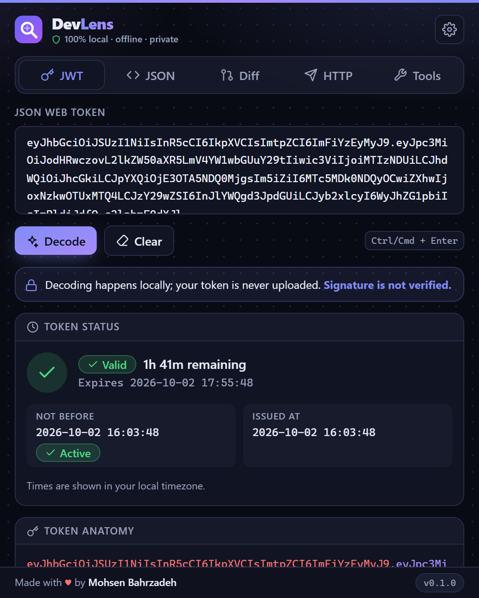
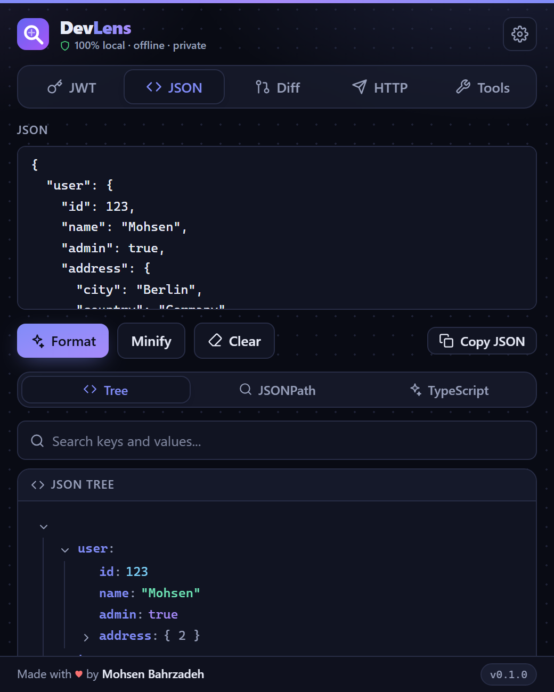
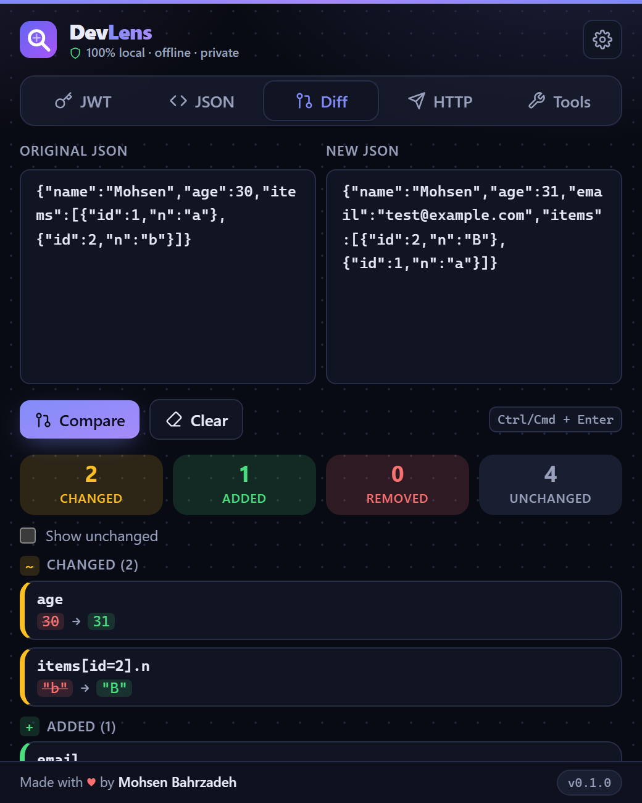
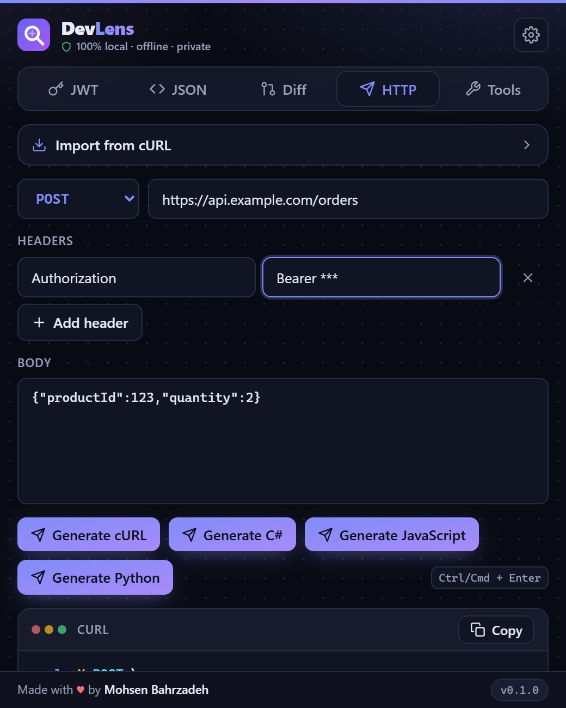

# DevLens

A privacy-first developer toolbox for inspecting JWTs, JSON, HTTP requests and encoded data directly in your browser.

DevLens is a Chrome extension (Manifest V3) that docks next to your page (Chrome side panel) and inside DevTools. Everything runs locally: no backend, no analytics, no network access.

## Features

| Module          | What it does                                                                                                                                                                                                                                                                                                                                                                                                                                                                                                                       |
| --------------- | ---------------------------------------------------------------------------------------------------------------------------------------------------------------------------------------------------------------------------------------------------------------------------------------------------------------------------------------------------------------------------------------------------------------------------------------------------------------------------------------------------------------------------------- |
| **JWT**         | Decode header/payload (accepts `Bearer …`, `Authorization: …`, quoted input), claim hints, `exp` / `nbf` / `iat` status in local time. **Verify** HS/RS/PS/ES signatures locally with a secret, PEM public key or JWK. **Security review** (alg `none`, `jku`/`x5u`/`jwk`, missing or very long `exp`, …). **Create** HMAC-signed test tokens. Keys can be PEM, JWK or a whole **JWKS** (chosen by `kid`).                                                                                                                         |
| **JSON**        | Format, minify, tree, search, **JSONPath**, one-click **repair** of broken JSON. **Convert** to TypeScript, Zod, C# records, Python (Pydantic), Java records, Go structs, YAML, CSV, XML; XML → JSON.                                                                                                                                                                                                                                                                                                                              |
| **Diff**        | Structural diff. Arrays of objects with a unique `id`/`_id`/`key`/`uuid` are matched by identity (`items[id=2]`). **Ignore rules** (`updatedAt`, `items[*].id`, `**.ts`), list or **side-by-side** view, copy as Markdown/JSON.                                                                                                                                                                                                                                                                                                    |
| **HTTP**        | Raw, form, **multipart** and **GraphQL** bodies. Generate **cURL**, **C#** (plain or **typed models + client + usage example** from a sample response), **JavaScript fetch**, **Python requests**. **Import** from cURL, raw HTTP or an **OpenAPI** document. Optional saved requests (off by default; secrets stripped).                                                                                                                                                                                                          |
| **Tools**       | Base64, URL encode/decode, query-string parser & builder, Unix timestamps, UUID inspector, **UUID v4/v7 / ULID / random string generator**, **SHA & HMAC hashes**, **regex tester**, **HTTP status code reference**.                                                                                                                                                                                                                                                                                                               |
| **DevTools**    | A "DevLens" tab in Chrome DevTools with the whole toolbox plus a **Network** inspector: decode Bearer tokens, copy any request as cURL / C# / fetch / Python (optionally with secrets masked), generate **typed models and a C# client from the real response**, and open a per-request **Journey**: final status with a plain-language diagnosis, connection (IP, protocol, TLS), timing waterfall, redirect chain, CORS preflight, and CDN / proxy hops _inferred from headers_ (DevLens cannot see raw packets or router hops). |
| **Right-click** | Select text on any page → "Inspect with DevLens" opens the matching tool (JWT, JSON, UUID, timestamp, query string, URL-encoded, Base64).                                                                                                                                                                                                                                                                                                                                                                                          |

Also: light / dark / system theme, Ctrl/Cmd + Enter to run the current action, **Ctrl+Shift+L** to open the side panel, copy buttons everywhere, keyboard-navigable tabs, and status shown with text and icons rather than colour alone.

## Screenshots

Dark and light themes are both supported (`*-light.png` variants are in `docs/screenshots/`).

| JWT                              | JSON                               | Diff                               | HTTP                               |
| -------------------------------- | ---------------------------------- | ---------------------------------- | ---------------------------------- |
|  |  |  |  |

## Installation

```bash
git clone <repository>
cd devlens
npm install
npm run build
```

Then in Chrome: **Extensions → Developer mode → Load unpacked → select the `dist/` folder**.

## Development

```bash
npm run dev          # Vite dev server (renders the UI in a normal tab)
npm run build        # type-check and produce dist/ (the unpacked extension)
npm run typecheck    # tsc --noEmit
npm run lint         # ESLint
npm run format       # Prettier
npm test             # Vitest (single run)
npm run test:watch   # Vitest watch mode
```

Chrome-only APIs (storage, context menu, DevTools) are unavailable under `npm run dev`; the UI guards for that. Test the real extension by loading `dist/` unpacked.

## Architecture

```
src/
├── app/            App shell (theme, tabs) and routes.ts (the list of tools)
├── components/     Shared UI: Button, Input, TextArea, Tabs, JsonTree, StatusBadge, CopyButton, ErrorMessage
├── features/       One folder per tool; each is independent
│   ├── jwt/        components/ types/ utils/token.ts
│   ├── json/       components/
│   ├── diff/       components/ utils/diff.ts
│   ├── http/       components/ generators/{curl,csharp}.ts types/
│   └── encoding/   components/ utils/{url,timestamp,uuid}.ts
├── hooks/          useCtrlEnter, useTheme
├── lib/            Pure shared logic: json.ts, base64.ts, clipboard.ts, storage.ts
└── types/          Result<T> / AppError
public/             manifest.json (MV3) and icons, copied verbatim into dist/
tests/              Vitest unit and component tests
```

Principles:

- **Logic is pure and separate from React.** Parsers, diff and generators are small functions returning `Result<T>` (`{ ok: true, value } | { ok: false, error }`), so errors are always human-readable and never thrown into the UI.
- **Adding a tool** means creating a folder under `features/` and adding one entry to `src/app/routes.ts`.
- User content is only ever rendered through React (no `dangerouslySetInnerHTML`, `eval` or `new Function`; ESLint forbids the latter two).

## Privacy

- All processing happens in the extension pages (side panel / DevTools); there is no backend and no external API.
- The extension's CSP sets `connect-src 'none'`, so its pages cannot make network requests. Permissions are only `storage`, `contextMenus` and `sidePanel`, with no host access (a test enforces this). See [PRIVACY.md](PRIVACY.md).
- Only UI preferences (theme, last tab, default output language) are written to `chrome.storage.local`. Tokens, JSON, headers, bodies, keys and secrets are held in React state only and disappear when the side panel or DevTools window closes.
- Optional saved requests are **off by default**; secret headers and token query parameters are always removed before saving.
- Text selected through the right-click menu is passed through in-memory `chrome.storage.session` and deleted as soon as the side panel reads it.

## Publishing to the Chrome Web Store

```bash
npm run package        # builds and creates release/devlens-<version>.zip
npm run store:assets   # screenshots (1280×800) and promo tiles into docs/store/
```

Listing text, permission justifications and the submission checklist are in
[docs/STORE_LISTING.md](docs/STORE_LISTING.md); the privacy policy is [PRIVACY.md](PRIVACY.md).
Pushing a `v*` tag runs the release workflow, which attaches the zip to a GitHub release.

## Testing

```bash
npm test
```

Unit tests cover JWT decoding and time status, JSON parse/format/minify/search, structural diff, Base64/URL/timestamp/UUID, and the cURL/C# generators. A few component tests exercise the JWT and JSON panels and the copy button.

## Roadmap

- **0.2** DevTools integration, request history/replay, import/export, shortcut customisation
- **0.3** Network inspector, OpenAPI viewer, GraphQL inspector, HAR viewer
- **0.4** VS Code extension, JetBrains plugin
- **0.5** `devlens` CLI
- **1.0** Unified toolkit across all of the above

## Contributing

See [CONTRIBUTING.md](CONTRIBUTING.md). Report vulnerabilities as described in [SECURITY.md](SECURITY.md).

## Author

Designed and developed by **Mohsen Bahrzadeh** — [Mohsen.Bahrzadeh@Gmail.com](mailto:Mohsen.Bahrzadeh@Gmail.com).

## License

[MIT](LICENSE)
